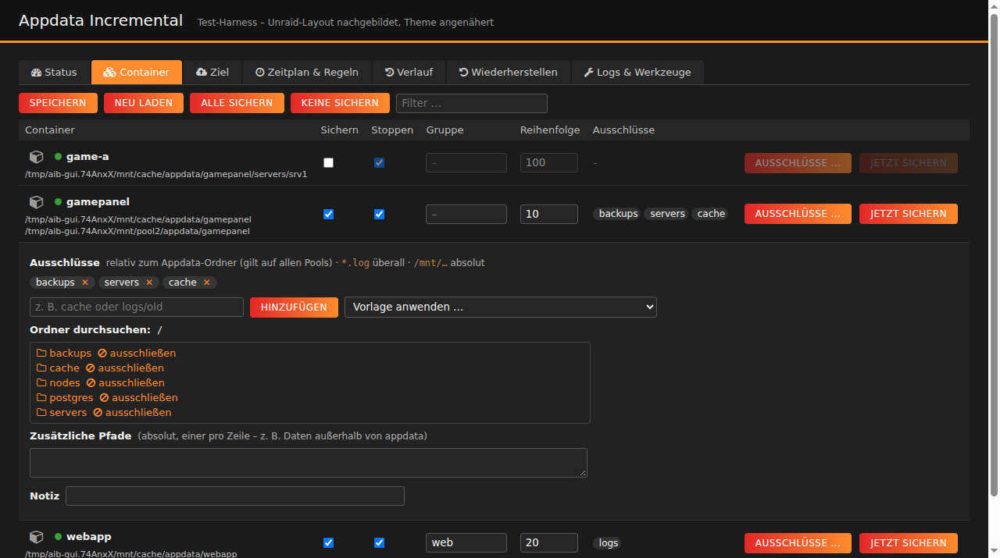

# Appdata Incremental für Unraid

Inkrementelle, deduplizierte Backups von Docker-Appdata mit [restic](https://restic.net), als Unraid-Plugin mit eigener WebGUI.
Die Bedienung orientiert sich an „Appdata Backup“: Container-Auswahl, Stoppen ja/nein, Gruppen, Reihenfolge und Ausschlüsse pro Container.
Dazu kommen Versionsverlauf, Deduplizierung und Wiederherstellung einzelner Dateien.

> **Status: Beta.** Alles ist über die Unraid-Oberfläche bedienbar (Einstellungen → User Utilities → **Appdata Incremental**).
> Bitte zuerst parallel zum bisherigen Backup betreiben und eine Wiederherstellung testen.



## Funktionen

- **Alle Container** werden über Docker erkannt, auch solche ohne Unraid-Vorlage (Compose, andere Verwaltungs-Tools). Angezeigt werden sie mit Icon, Status und Pfaden.
- **Kurze Ausfallzeit**: Container stoppen → btrfs- oder ZFS-Snapshot (Sekunden) → Container starten → aus dem Snapshot sichern.
- **Inkrementell und dedupliziert** mit restic. Jede Sicherung ist eine vollständige Version; übertragen werden nur Änderungen.
- **Auf mehrere Pools verteilte Appdata** (`/mnt/user/appdata/X` liegt teils auf `cache`, teils auf einem anderen Pool) wird vollständig gesichert und wiederhergestellt.
- **Pro Container**: sichern ja/nein, stoppen ja/nein, Gruppe, Reihenfolge, Ausschlüsse (per Klick im Ordner-Browser oder über Vorlagen), zusätzliche Pfade.
- **Regeln für neue Container**, z. B. Ausschlüsse oder Abwahl anhand des Mount-Pfads.
- Zusätzlich gesichert werden `docker inspect` und die Unraid-Vorlage des Containers.
- **Verlauf**: Versionen je Container mit Datum, Größe, neu hochgeladenen Daten und den geänderten Dateien gegenüber der Vorversion.
- **Wiederherstellung**:
  - ganzer Container oder einzelne Dateien und Ordner, ausgewählt im Dateibaum
  - in einen Ordner oder an Ort und Stelle; der alte Stand wird nach `.aib-pre-restore-<Zeit>` verschoben, nicht gelöscht
- **Aufbewahrung** täglich, wöchentlich, monatlich und jährlich; dazu `prune` und `check` nach Zeitplan.
- **Weitere Bedienung über die Oberfläche**: Zeitplan, Live-Log mit Fortschritt, Log-Historie, Abbrechen-Knopf, Unraid-Benachrichtigungen.
- **Einrichtung komplett in der Oberfläche**:
  - SFTP-Ziel
  - SSH-Schlüssel erzeugen und auf dem Server hinterlegen
  - Repository-Passwort erzeugen, mit Einmal-Anzeige und Download
  - Verbindung testen und Repository initialisieren
- restic wird beim Installieren aus dem **offiziellen Release** geladen und per SHA256 geprüft. Auch die Plugin-Dateien werden per SHA256 geprüft und auf dem USB-Stick zwischengespeichert, damit ein Neustart ohne Internet funktioniert.

## Installation

Unraid → **Plugins** → **Install Plugin** → diese URL eintragen:

```
https://raw.githubusercontent.com/gottschalkfelix4-source/unraid-appdata-incremental/main/appdata-incremental.plg
```

Voraussetzung: Unraid 7.0 oder neuer. Updates erscheinen unter Plugins → „Check for updates“.

## Einrichtung (in der Oberfläche)

Einstellungen → User Utilities → **Appdata Incremental**. Das Hilfe-Symbol im Unraid-Header blendet zu jedem Feld eine Erklärung ein.

1. **Ziel**
   - **Art des Ziels** wählen. Bei SFTP, z. B. einer Hetzner Storage Box (Port 23, SSH-Support im Konto aktivieren), Host, Benutzer, Port und Pfad eintragen und **Ziel speichern**.
   - **Schlüssel erzeugen** und dann **Schlüssel hinterlegen**. Dafür einmalig das Passwort des Zielkontos eingeben; es wird nicht gespeichert und nicht geloggt. Alternativ den angezeigten öffentlichen Schlüssel selbst beim Anbieter eintragen.
   - **Passwort erzeugen** oder ein eigenes eingeben. Das erzeugte Passwort wird **einmal** angezeigt und kann als Datei heruntergeladen werden: unbedingt im Passwortmanager speichern. Ohne dieses Passwort sind die Backups unbrauchbar.
   - **Verbindung testen**, dann **Repository initialisieren**.
2. **Container**: Auswahl prüfen, bei Bedarf Ausschlüsse setzen, dann **Speichern**.
3. **Zeitplan & Regeln**: Zeitplan, Aufbewahrung und Benachrichtigungen einstellen, dann **Übernehmen**.
4. **Logs & Werkzeuge**:
   - **Systemcheck** zeigt den Plan des nächsten Laufs.
   - **Snapshot-Selbsttest** prüft btrfs/ZFS, ohne einen Container zu stoppen.
5. **Status**: Mit **Backup jetzt starten** läuft der erste Lauf. Fortschritt und Log erscheinen live.

Vorbereitete Einstellungen, etwa Regeln und Ausschlüsse, lassen sich unter *Zeitplan & Regeln → Konfiguration importieren* als JSON-Datei übernehmen. Ein Beispiel steht in [docs/examples/config.example.json](docs/examples/config.example.json). Schlüssel und Passwort werden dabei nie gelesen oder verändert.

## Seiten

| Tab | Inhalt |
|---|---|
| Status | Zustand, Fortschritt, „Backup jetzt starten“, Testlauf, Abbrechen, letzter Lauf je Container (neue Daten, Ausfallzeit), Live-Log |
| Container | alle Container mit Icon, Status und Pfaden; sichern, stoppen, Gruppe, Reihenfolge, Ausschlüsse (Ordner-Browser, Vorlagen), Zusatzpfade, „Jetzt sichern“ |
| Ziel | Backup-Ziel, SSH-Schlüssel, Repository-Passwort, Verbindung testen, Repository initialisieren |
| Zeitplan & Regeln | Zeitplan, prune und check, Aufbewahrung, Benachrichtigungen, Snapshot-Optionen, globale Ausschlüsse, Regeln für neue Container, Import und Export |
| Verlauf | Versionen je Container mit Größe, neuen Daten, Details und geänderten Dateien |
| Wiederherstellen | Container und Version wählen, ganz oder Dateibaum, Ziel Ordner oder an Ort und Stelle, Container stoppen und starten |
| Logs & Werkzeuge | Systemcheck mit Plan, Snapshot-Selbsttest, Wartung (Aufbewahrung, prune, check, Sperren lösen), Log-Historie |

Screenshots: [docs/screenshots](docs/screenshots). Sie stammen aus dem Test-Harness mit Beispieldaten; das Theme ist dort nur angenähert.

## Sicherheit

- Geheimnisse liegen nur unter `/boot/config/plugins/appdata-incremental/secrets/`:
  - Repository-Passwort
  - privater SSH-Schlüssel
  - known_hosts
- Sie werden nie geloggt und nie an die Oberfläche geschickt. Ausnahme ist die bewusste Einmal-Anzeige eines neu erzeugten Passworts.
- Das Zielkonto-Passwort zum Hinterlegen des Schlüssels wird nur an diesen einen `ssh`-Aufruf übergeben (`SSH_ASKPASS`) und nirgends gespeichert.
- Alle Anfragen der Oberfläche sind POST mit Unraid-CSRF-Token. Die Eingaben werden geprüft: Containernamen, Pfade ohne `..`, Hosts, Cron-Felder und Snapshot-IDs.
- Programme werden ohne Shell mit Argumentlisten aufgerufen.
- Der USB-Stick ist FAT32 und speichert keine Dateirechte. Für `ssh` nutzt das Plugin deshalb eine Kopie des Schlüssels mit Rechten 0600 im RAM.

## Wie der Snapshot funktioniert

- **btrfs**: Ein Read-only-Snapshot des Subvolumes, in dem der Ordner liegt, unter `<pool>/appdata/.aib-snapshots/`. Liegt appdata nicht in einem eigenen Subvolume, wird das Top-Level-Subvolume des Pools gesnapshottet. Das geht ebenfalls in Sekunden.
- **ZFS**: `zfs snapshot <dataset>@aib`, gelesen über `.zfs/snapshot/aib`.
- restic läuft in einem privaten Mount-Namespace, in dem der Snapshot per Bind-Mount über dem Originalpfad liegt. Im Repository stehen deshalb die echten Pfade, und Inkremente und Wiederherstellung funktionieren ohne Umweg.
- Andere Dateisysteme (XFS-Array-Disks) haben keinen Snapshot. Diese Container werden im gestoppten Zustand gesichert.
- Übrig gebliebene Snapshots eines abgebrochenen Laufs werden gelöscht, Container, die er gestoppt hatte, wieder gestartet. Das passiert sofort beim Abbrechen oder spätestens beim nächsten Lauf.

## Dateien

| Ort | Inhalt |
|---|---|
| `/boot/config/plugins/appdata-incremental/config.json` | Konfiguration |
| `/boot/config/plugins/appdata-incremental/secrets/` | Repository-Passwort, SSH-Schlüssel, known_hosts |
| `/boot/config/plugins/appdata-incremental/logs/` | Logs der letzten Läufe |
| `/boot/config/plugins/appdata-incremental/pkg/`, `bin/` | Zwischenspeicher für Plugin-Dateien und restic |
| `/usr/local/emhttp/plugins/appdata-incremental/` | Oberfläche und Programm (RAM, bei jedem Start neu installiert) |

Die Deinstallation entfernt nur die Programme. Konfiguration, Schlüssel, Logs und das Repository bleiben.

## Kommandozeile (optional)

Für den normalen Betrieb nicht nötig. `aib help` zeigt alle Befehle, zum Beispiel:

```bash
aib doctor
aib plan
aib backup --container <name>
aib snapshots
aib restore-container <name> --snapshot latest --target /mnt/user/restore/x
```

## Grenzen

- Docker **Named Volumes** werden nicht gesichert, nur Bind-Mounts unterhalb der Appdata-Ordner. Weitere Pfade sind über „Zusätzliche Pfade“ möglich.
- Verschachtelte btrfs-Subvolumes unterhalb eines Appdata-Ordners sind im Snapshot leer.

## Entwicklung

```bash
PHP=php RESTIC=restic tests/run-tests.sh                                   # Kernlogik (Docker-Mock, lokales Repo)
PHP=php RESTIC=restic JQUERY=jquery.min.js tests/test-gui.sh                # API und Oberfläche über HTTP (Test-Harness)
SERVE=1 PHP=php RESTIC=restic JQUERY=jquery.min.js tests/test-gui.sh        # Harness danach im Browser ansehen
PHP=php RESTIC_BZ2=restic_0.19.1_linux_amd64.bz2 tests/test-plg.sh         # Installer gegen lokalen Server
```

Release:
1. `src/` und `CHANGELOG.md` committen.
2. `python3 build.py --version <JJJJ.MM.TT[a-z]> --ref <commit-sha>` ausführen.
3. `appdata-incremental.plg` committen.

## Lizenz

MIT, siehe [LICENSE](LICENSE). restic wird nicht mitgeliefert, sondern aus dem offiziellen Release geladen (BSD-2-Clause).
